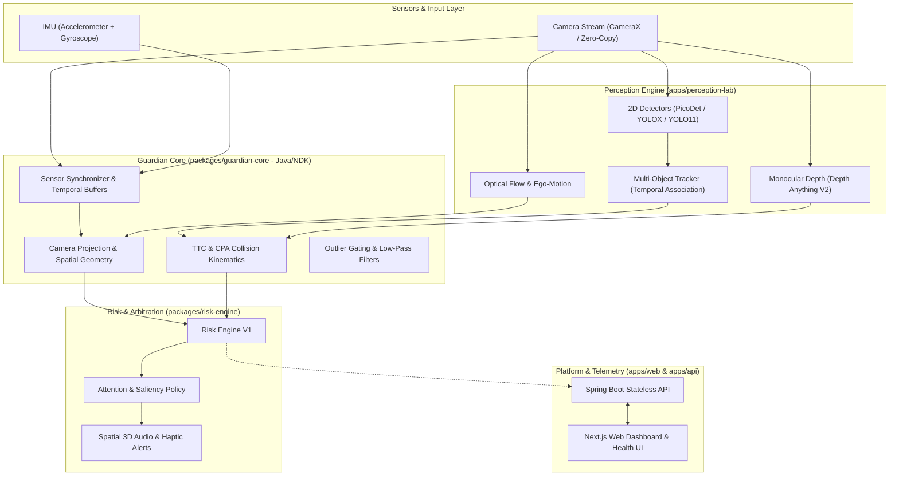

# VISION: Real-Time Spatial AI & Assistive Navigation Guardian

[](#checks-and-verification)
[](packages/guardian-core)
[](apps/web)
[](apps/api)
[](apps/perception-lab)
[](LICENSE)
[-red.svg)](#-30-stage-engineering-roadmap)

> **VISION** is an edge-first spatial artificial intelligence and real-time obstacle avoidance platform designed to empower individuals with situational awareness, predictive collision prevention, and natural assistive navigation.

---

## 🎯 Executive Overview & Mission

VISION bridges high-speed on-device computer vision with deterministic spatial geometry and physics-based risk estimation. Rather than relying on fragile cloud APIs or delayed LLM inferences for safety-critical navigation, VISION executes a tightly synchronized edge pipeline:

1. **Sub-millisecond Sensor Alignment**: High-frequency IMU and camera timestamps synchronized with rolling-shutter compensation.
2. **Deterministic Geometric Projection**: Strict pinhole camera transforms, lens distortion rectification, and ground-plane ray-casting.
3. **Multi-Model Edge Perception**: Decoupled object detection (PicoDet / YOLOX / RT-DETR), monocular metric depth (Depth Anything V2), and sparse/dense optical flow.
4. **Predictive Risk & Trajectory Arbitration**: Closed-form Time-to-Collision (TTC) and Closest Point of Approach (CPA) calculations powering cognitive-load-aware spatial audio warnings.

---

## 🏗️ System Architecture



---

## 🗺️ 30-Stage Engineering Roadmap

The complete development lifecycle of VISION is organized into 30 rigorous engineering milestones spanning mathematical foundations, multi-modal perception, edge integration, cloud synchronization, and safety verification.

```
═══════════════════════════════════════════════════════════════════════════════════════
STAGE   MILESTONE / WORK STREAM                       PHASE / STATUS
═══════════════════════════════════════════════════════════════════════════════════════
002  │  Mathematical / Domain Foundation            │  Core Infrastructure  [DONE]
003  │  Geometry + Camera Projection + Calibration   │  Core Infrastructure  [DONE]
004  │  Filtering + Sensor Timing + Motion Est.     │  Core Infrastructure  [DONE]
005  │  Desktop Perception Laboratory                │  R&D Workbench        [DONE]
006  │  Detector Integration + Model Bake-Off       │  Perception Subsystem  [DONE]
007  │  Multi-Object Tracking                        │  Perception Subsystem  [DONE]
008  │  Depth Subsystem                              │  Spatial Sensing       [DONE]
009  │  Optical Flow + Ego-Motion                   │  Spatial Sensing       [ACTIVE]
010  │  Semantic / Walkable-Space Understanding      │  Spatial Geometry      [PLANNED]
011  │  Persistent World Model                       │  Spatial Geometry      [PLANNED]
012  │  User Corridor + Free-Space Reasoning        │  Spatial Geometry      [PLANNED]
013  │  Trajectory Prediction                        │  Predictive Kinematics [PLANNED]
014  │  TTC / CPA / Collision Mathematics           │  Predictive Kinematics [DONE in Core]
015  │  Risk Engine V1                               │  Decision & Alerts     [PLANNED]
016  │  Attention Engine                             │  Decision & Alerts     [PLANNED]
017  │  Alert Language / Audio Arbitration          │  Decision & Alerts     [PLANNED]
018  │  Replay / Evaluation Framework                │  Validation & Test     [ACTIVE]
019  │  Android Reinstatement + CameraX              │  Mobile Edge Runtime   [PLANNED]
020  │  On-Device Inference Runtime                  │  Mobile Edge Runtime   [PLANNED]
021  │  Sensor Fusion on Android                     │  Mobile Edge Runtime   [PLANNED]
022  │  Guardian Complete Runtime                    │  Mobile Edge Runtime   [PLANNED]
023  │  Voice Commands                               │  Multimodal Interface  [PLANNED]
024  │  Explore / VLM / OCR Mode                     │  Multimodal Interface  [PLANNED]
025  │  Backend Persistence / Auth / Devices        │  Cloud Infrastructure  [ACTIVE]
026  │  Web Dashboard                                │  Cloud Infrastructure  [DONE]
027  │  Telemetry / Model Registry / Remote Config   │  Cloud Infrastructure  [PLANNED]
028  │  Latency + Thermal + Battery Optimization     │  Hardening & QA        [PLANNED]
029  │  Safety / Failure-Mode Hardening              │  Hardening & QA        [PLANNED]
030  │  Final YC Demo + Evaluation + Documentation   │  Production & Showcase [TARGET]
═══════════════════════════════════════════════════════════════════════════════════════
```

### Milestone Breakdown

<details open>
<summary><b>Phase 1: Mathematical Foundations & Edge Core (Stages 002 – 005)</b></summary>

- **002 Mathematical / Domain Foundation**: Zero-external-dependency Vector2, Vector3, Quaternion, RigidTransform, and monotonic temporal structures.
- **003 Geometry + Camera Projection + Calibration**: Pin-hole projection, radial-tangential lens distortion models, rolling-shutter compensation, ground plane intersection.
- **004 Filtering + Sensor Timing + Motion Estimation**: High-frequency IMU alignment, outlier gating, stationary detection, low-pass & median filters.
- **005 Desktop Perception Laboratory**: Headless Python replay framework with PyAV and strictly typed evaluation interfaces.
</details>

<details open>
<summary><b>Phase 2: Vision, Depth & Motion Perception (Stages 006 – 010)</b></summary>

- **006 Detector Integration + Model Bake-Off**: Benchmark evaluation of PicoDet, YOLOX, YOLO11, and RT-DETR on real-world pedestrian and first-person video datasets.
- **007 Multi-Object Tracking**: Decoupled 2D temporal association, ByteTrack-style association matrices, identity history, and velocity estimation.
- **008 Depth Subsystem**: Model-independent depth maps via Depth Anything V2 with metric scaling and bounding-box spatial sampling.
- **009 Optical Flow + Ego-Motion**: Robust Lucas-Kanade and dense optical flow for camera ego-motion decoupling and residual image-motion vectors.
- **010 Semantic / Walkable-Space Understanding**: Ground plane obstacle boundary detection, curb/drop-off classification, and terrain traversability.
</details>

<details>
<summary><b>Phase 3: World Modeling & Trajectory Kinematics (Stages 011 – 014)</b></summary>

- **011 Persistent World Model**: Ego-centric 2.5D/3D local occupancy grid with temporal decay and landmark anchoring.
- **012 User Corridor + Free-Space Reasoning**: Dynamic clearance funnel projection based on user walking speed, heading, and body width.
- **013 Trajectory Prediction**: Physics-constrained linear & curvilinear state forecasting for dynamic obstacles (pedestrians, cyclists, vehicles).
- **014 TTC / CPA / Collision Mathematics**: Analytic closest point of approach ($t_{\text{CPA}}$), distance at closest approach ($d_{\text{CPA}}$), and thresholded time-to-collision alarms.
</details>

<details>
<summary><b>Phase 4: Risk, Attention & Audio Arbitration (Stages 015 – 018)</b></summary>

- **015 Risk Engine V1**: Deterministic multi-factor hazard scoring fusing proximity, closing speed, orientation, and pedestrian corridor intrusion.
- **016 Attention Engine**: Cognitive load management suppressing redundant warnings and selecting dominant directional hazards.
- **017 Alert Language / Audio Arbitration**: 3D spatialized binaural audio pings, dynamic haptic pulse trains, and concise natural-language warnings.
- **018 Replay / Evaluation Framework**: Deterministic regression pipeline executing continuous verification on frozen raw sensory captures.
</details>

<details>
<summary><b>Phase 5: Mobile Edge Runtime & Multimodal AI (Stages 019 – 024)</b></summary>

- **019 Android Reinstatement + CameraX**: High-efficiency Android application pipeline with direct surface texture buffers and zero-copy NDK bindings.
- **020 On-Device Inference Runtime**: Quantized INT8 execution via ONNX Runtime Mobile, NNAPI, and Qualcomm QNN delegates.
- **021 Sensor Fusion on Android**: Hardware timestamp synchronization bridging Android Camera2 metadata and IMU FIFO buffers.
- **022 Guardian Complete Runtime**: Autonomous background service managing frame dispatch, safety watchdogs, and fault isolation.
- **023 Voice Commands**: Low-latency edge wake-word listening for conversational status queries and mode toggling.
- **024 Explore / VLM / OCR Mode**: On-demand scene narrative, reading of signs/menus, and contextual visual question answering.
</details>

<details>
<summary><b>Phase 6: Cloud Platform, Hardening & YC Demo (Stages 025 – 030)</b></summary>

- **025 Backend Persistence / Auth / Devices**: Java 21 / Spring Boot API managing device fleets, user preferences, and secure synchronization.
- **026 Web Dashboard**: Production Next.js operational suite rendering real-time device health, telemetry logs, and configuration matrices.
- **027 Telemetry / Model Registry / Remote Config**: Over-the-air model updates, safety metric aggregation, and remote feature gating.
- **028 Latency + Thermal + Battery Optimization**: Adaptive frame skipping, throttling controls, and thermal safety boundaries for all-day wearable use.
- **029 Safety / Failure-Mode Hardening**: Formal fault trees, degraded camera fallback modes, sensor failure alarms, and watchdogs.
- **030 Final YC Demo + Evaluation + Documentation**: Complete production demonstration, validation whitepaper, and live evaluation harness.
</details>

---

## 📂 Repository Structure

```
VISION/
├── apps/
│   ├── api/                    # Java 21 / Spring Boot stateless REST API & health services
│   ├── perception-lab/         # Python 3.12 desktop laboratory for offline model R&D & replay
│   └── web/                    # Next.js 15+ / React / Tailwind CSS operator interface
├── packages/
│   ├── guardian-core/          # Pure Java 8-compatible mathematical & spatial geometry library
│   ├── contracts/              # Protocol specifications & cross-boundary schemas
│   ├── geometry/               # Spatial geometry & camera calibration contracts
│   ├── perception/             # Perception orchestration specifications
│   ├── trajectory/             # Temporal prediction & tracking definitions
│   ├── risk-engine/            # Multi-hazard risk assessment models
│   ├── attention-engine/       # Saliency filtering & audio arbitration contracts
│   └── evaluation/             # Test harness definitions & evaluation suites
├── docs/                       # Architectural Decision Records (ADRs) & procedure docs
├── datasets/                   # Diagnostic dataset manifests & first-person sample fixtures
├── tools/                      # Node.js & Python orchestration scripts, doctor, and smoke tests
└── compose.yaml                # Optional Docker Compose configuration (PostgreSQL, MinIO, Redis)
```

---

## ⚡ Quick Start & Development

### 1. Prerequisites
- **Node.js**: `22.21.0` or higher, npm `10+`
- **JDK**: `Java 21` (with `JAVA_HOME` configured)
- **Python**: `3.12` (for desktop perception lab)
- **Maven**: Pre-configured via checked-in wrapper (`mvnw`)

### 2. Environment Verification
Verify your machine setup before starting:
```powershell
npm run doctor
```

### 3. Launch Web Dashboard
```powershell
npm ci
npm run dev:web
```
Access the web dashboard at `http://127.0.0.1:3000` and the health monitor at `http://127.0.0.1:3000/health`.

### 4. Launch API Service
In a separate terminal:
```powershell
npm run dev:api
```
Verify API liveness and readiness:
```powershell
Invoke-RestMethod http://127.0.0.1:8000/health/live
Invoke-RestMethod http://127.0.0.1:8000/health/ready
```

### 5. Perception Laboratory (Python R&D)
```powershell
npm run lab:setup
npm run check:lab
```

---

## 🧪 Checks and Verification

To execute all formatting, compilation, test suites, and integration smoke checks:

```powershell
npm run check             # Lint, compile, unit test across all packages
npm run check:core        # Pure Java 8 math & geometry tests in packages/guardian-core
npm run check:web         # ESLint, TypeScript checking, and Vitest suite
npm run check:api         # Maven JUnit tests, compiler lint, and SpotBugs
npm run check:lab         # Ruff lint, strict mypy, and PyTest perception suite
npm run verify            # Complete local verification & production smoke test
```

---

## 🛡️ Safety & Engineering Policy

1. **Safety Separation**: Research code in `apps/perception-lab` is strictly isolated from safety-critical mobile execution contracts.
2. **Deterministic Primitives**: `packages/guardian-core` contains zero floating-point ambiguities or native hardware dependencies, ensuring exact mathematical reproducibility across Android, server, and desktop.
3. **Fail-Safe Design**: Missing depth, occluded optics, or sensor desynchronization trigger explicit uncertainty states rather than speculative guidance.

---

## 📄 License & Attribution

This repository is licensed under the [MIT License](LICENSE). Built for high-reliability spatial AI and assistive robotics research.