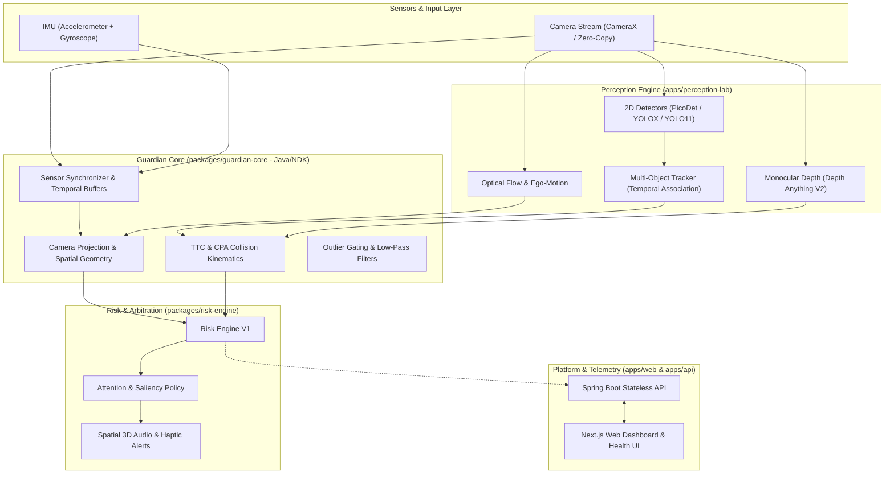

# VISION: Real-Time Spatial AI & Assistive Navigation Guardian

[](packages/guardian-core)
[](apps/web)
[](apps/api)
[](apps/perception-lab)
[](LICENSE)

## Product V1.1 / Controlled Alpha V1

Run `npm.cmd run dev:web` and open the displayed loopback address for the public
product experience. `/demo` is a text-only explanation, not the raw research video.
Private replay, metrics and review live under authenticated `/lab`; see the
[public/private web guide](docs/releases/VISION_PUBLIC_WEB_DEPLOYMENT.md).
`npm run build:public` creates the isolated static marketing artifact.
For USB-free sessions, use the [wireless field guide](docs/releases/VISION_WIRELESS_ALPHA_FIELD_GUIDE.md).
The [implemented architecture](docs/architecture/VISION_SYSTEM_ARCHITECTURE_V2.md)
and [Product V1.1 checklist](docs/releases/VISION_PRODUCT_V1_1_CHECKLIST.md) distinguish
software checks from physical acceptance. For the qualification results, legacy field
pairing instructions, and the thirty-window reviewer workflow, see the
[engine release](docs/releases/VISION_CONTROLLED_ALPHA_V1.md),
[demo guide](docs/demo/VISION_ALPHA_DEMO.md), and
[field guide](docs/releases/VISION_ALPHA_V1_FIELD_GUIDE.md).
The [November 6 closure report](docs/research/results/vision-controlled-alpha-v1-final-2026-11-06.md)
records executed checks, audit findings and the remaining physical evaluation gates.
This is a supervised local engineering prototype. Human usefulness and physical
safety require independent evaluation.

> **VISION** is a local research prototype exploring assistive scene understanding.
> It is not validated for navigation, collision prevention or unsupervised mobility.

---

## 🎯 Executive Overview & Mission

VISION is currently a local prototype for perception, spatial geometry and evidence-aware interaction relevance. Physical risk and production safety are unvalidated, and the full pipeline is below wearable real-time requirements. The following capabilities and architecture describe implemented research components alongside the longer-term target:

1. **Sensor Alignment Research**: Timestamp, pose and rolling-shutter utilities; actual sensor synchronization requires hardware validation.
2. **Deterministic Geometric Projection**: Strict pinhole camera transforms, lens distortion rectification, and ground-plane ray-casting.
3. **Perception Research**: Replaceable object detection, explicitly relative/unvalidated depth, segmentation and optical-flow adapters.
4. **Prototype Risk Evidence**: Corridor and interaction evidence feed attention and text presentation. The Android field harness implements local TTS; physical audio delivery remains unverified. Guardian-owned TTC/CPA remain research diagnostics.

---

## 🏗️ System Architecture

Target architecture; this diagram includes planned mobile and alert components. See the task reports below for implemented and verified scope.



---

## 🗺️ 30-Stage Engineering Roadmap

The complete development lifecycle of VISION is organized into 30 rigorous engineering milestones spanning mathematical foundations, multi-modal perception, edge integration, cloud synchronization, and safety verification.

```
═══════════════════════════════════════════════════════════════════════════════════════
STAGE   MILESTONE / WORK STREAM                       PHASE / STATUS
═══════════════════════════════════════════════════════════════════════════════════════
002  │  Mathematical / Domain Foundation            │  Core Infrastructure  [DONE]
003  │  Geometry + Camera Projection + Calibration   │  Core Infrastructure  [DONE]
004  │  Filtering + Sensor Timing + Motion Est.     │  Core Infrastructure  [DONE]
005  │  Desktop Perception Laboratory                │  R&D Workbench        [DONE]
006  │  Detector Integration + Model Bake-Off       │  Perception Subsystem  [DONE]
007  │  Multi-Object Tracking                        │  Perception Subsystem  [DONE]
008  │  Depth Subsystem                              │  Spatial Sensing       [DONE]
009  │  Optical Flow + Ego-Motion                   │  Spatial Sensing       [ACTIVE]
010  │  Semantic / Walkable-Space Understanding      │  Spatial Geometry      [PLANNED]
011  │  Persistent World Model                       │  Spatial Geometry      [PLANNED]
012  │  User Corridor + Free-Space Reasoning        │  Spatial Geometry      [PLANNED]
013  │  Trajectory Prediction                        │  Predictive Kinematics [PLANNED]
014  │  TTC / CPA / Collision Mathematics           │  Predictive Kinematics [DONE in Core]
015  │  Risk Engine V1                               │  Decision & Alerts     [PLANNED]
016  │  Attention Engine                             │  Decision & Alerts     [PLANNED]
017  │  Alert Language / Audio Arbitration          │  Decision & Alerts     [PLANNED]
018  │  Replay / Evaluation Framework                │  Validation & Test     [ACTIVE]
019  │  Android Reinstatement + CameraX              │  Mobile Edge Runtime   [PLANNED]
020  │  On-Device Inference Runtime                  │  Mobile Edge Runtime   [PLANNED]
021  │  Sensor Fusion on Android                     │  Mobile Edge Runtime   [PLANNED]
022  │  Guardian Complete Runtime                    │  Mobile Edge Runtime   [PLANNED]
023  │  Voice Commands                               │  Multimodal Interface  [PLANNED]
024  │  Explore / VLM / OCR Mode                     │  Multimodal Interface  [PLANNED]
025  │  Backend Persistence / Auth / Devices        │  Cloud Infrastructure  [ACTIVE]
026  │  Web Dashboard                                │  Cloud Infrastructure  [DONE]
027  │  Telemetry / Model Registry / Remote Config   │  Cloud Infrastructure  [PLANNED]
028  │  Latency + Thermal + Battery Optimization     │  Hardening & QA        [PLANNED]
029  │  Safety / Failure-Mode Hardening              │  Hardening & QA        [PLANNED]
030  │  Final YC Demo + Evaluation + Documentation   │  Production & Showcase [TARGET]
═══════════════════════════════════════════════════════════════════════════════════════
```

### Milestone Breakdown

<details open>
<summary><b>Phase 1: Mathematical Foundations & Edge Core (Stages 002 – 005)</b></summary>

- **002 Mathematical / Domain Foundation**: Zero-external-dependency Vector2, Vector3, Quaternion, RigidTransform, and monotonic temporal structures.
- **003 Geometry + Camera Projection + Calibration**: Pin-hole projection, radial-tangential lens distortion models, rolling-shutter compensation, ground plane intersection.
- **004 Filtering + Sensor Timing + Motion Estimation**: High-frequency IMU alignment, outlier gating, stationary detection, low-pass & median filters.
- **005 Desktop Perception Laboratory**: Headless Python replay framework with PyAV and strictly typed evaluation interfaces.

</details>

<details open>
<summary><b>Phase 2: Vision, Depth & Motion Perception (Stages 006 – 010)</b></summary>

- **006 Detector Integration + Model Bake-Off**: Benchmark evaluation of PicoDet, YOLOX, YOLO11, and RT-DETR on real-world pedestrian and first-person video datasets.
- **007 Multi-Object Tracking**: Decoupled 2D temporal association, ByteTrack-style association matrices, identity history, and velocity estimation.
- **008 Depth Subsystem**: Model-independent depth maps via Depth Anything V2 with metric scaling and bounding-box spatial sampling.
- **009 Optical Flow + Ego-Motion**: Robust Lucas-Kanade and dense optical flow for camera ego-motion decoupling and residual image-motion vectors.
- **010 Semantic / Walkable-Space Understanding**: Ground plane obstacle boundary detection, curb/drop-off classification, and terrain traversability.

</details>

<details>
<summary><b>Phase 3: World Modeling & Trajectory Kinematics (Stages 011 – 014)</b></summary>

- **011 Persistent World Model**: Ego-centric 2.5D/3D local occupancy grid with temporal decay and landmark anchoring.
- **012 User Corridor + Free-Space Reasoning**: Dynamic clearance funnel projection based on user walking speed, heading, and body width.
- **013 Trajectory Prediction**: Physics-constrained linear & curvilinear state forecasting for dynamic obstacles (pedestrians, cyclists, vehicles).
- **014 TTC / CPA / Collision Mathematics**: Analytic closest point of approach ($t_{\text{CPA}}$), distance at closest approach ($d_{\text{CPA}}$), and thresholded time-to-collision alarms.

</details>

<details>
<summary><b>Phase 4: Risk, Attention & Audio Arbitration (Stages 015 – 018)</b></summary>

- **015 Risk Engine V1**: Deterministic multi-factor hazard scoring fusing proximity, closing speed, orientation, and pedestrian corridor intrusion.
- **016 Attention Engine**: Cognitive load management suppressing redundant warnings and selecting dominant directional hazards.
- **017 Alert Language / Audio Arbitration**: 3D spatialized binaural audio pings, dynamic haptic pulse trains, and concise natural-language warnings.
- **018 Replay / Evaluation Framework**: Deterministic regression pipeline executing continuous verification on frozen raw sensory captures.

</details>

<details>
<summary><b>Phase 5: Mobile Edge Runtime & Multimodal AI (Stages 019 – 024)</b></summary>

- **019 Android Reinstatement + CameraX**: High-efficiency Android application pipeline with direct surface texture buffers and zero-copy NDK bindings.
- **020 On-Device Inference Runtime**: Quantized INT8 execution via ONNX Runtime Mobile, NNAPI, and Qualcomm QNN delegates.
- **021 Sensor Fusion on Android**: Hardware timestamp synchronization bridging Android Camera2 metadata and IMU FIFO buffers.
- **022 Guardian Complete Runtime**: Autonomous background service managing frame dispatch, safety watchdogs, and fault isolation.
- **023 Voice Commands**: Low-latency edge wake-word listening for conversational status queries and mode toggling.
- **024 Explore / VLM / OCR Mode**: On-demand scene narrative, reading of signs/menus, and contextual visual question answering.

</details>

<details>
<summary><b>Phase 6: Cloud Platform, Hardening & YC Demo (Stages 025 – 030)</b></summary>

- **025 Backend Persistence / Auth / Devices**: Java 21 / Spring Boot API managing device fleets, user preferences, and secure synchronization.
- **026 Web Dashboard**: Production Next.js operational suite rendering real-time device health, telemetry logs, and configuration matrices.
- **027 Telemetry / Model Registry / Remote Config**: Over-the-air model updates, safety metric aggregation, and remote feature gating.
- **028 Latency + Thermal + Battery Optimization**: Adaptive frame skipping, throttling controls, and thermal safety boundaries for all-day wearable use.
- **029 Safety / Failure-Mode Hardening**: Formal fault trees, degraded camera fallback modes, sensor failure alarms, and watchdogs.
- **030 Final YC Demo + Evaluation + Documentation**: Complete production demonstration, validation whitepaper, and live evaluation harness.

</details>

---

## 📂 Repository Structure

```
VISION/
├── apps/
│   ├── api/                    # Java 21 / Spring Boot stateless REST API & health services
│   ├── perception-lab/         # Python 3.12 desktop laboratory for offline model R&D & replay
│   └── web/                    # Next.js 15+ / React / Tailwind CSS operator interface
├── packages/
│   ├── guardian-core/          # Pure Java 8-compatible mathematical & spatial geometry library
│   ├── contracts/              # Protocol specifications & cross-boundary schemas
│   ├── geometry/               # Spatial geometry & camera calibration contracts
│   ├── perception/             # Perception orchestration specifications
│   ├── trajectory/             # Temporal prediction & tracking definitions
│   ├── risk-engine/            # Multi-hazard risk assessment models
│   ├── attention-engine/       # Saliency filtering & audio arbitration contracts
│   └── evaluation/             # Test harness definitions & evaluation suites
├── docs/                       # Architectural Decision Records (ADRs) & procedure docs
├── datasets/                   # Diagnostic dataset manifests & first-person sample fixtures
├── tools/                      # Node.js & Python orchestration scripts, doctor, and smoke tests
└── compose.yaml                # Optional Docker Compose configuration (PostgreSQL, MinIO, Redis)
```

---

## ⚡ Quick Start & Development

### 1. Prerequisites

- **Node.js**: `22.21.0` or higher, npm `10+`
- **JDK**: `Java 21` (with `JAVA_HOME` configured)
- **Python**: `3.12` (for desktop perception lab)
- **Maven**: Pre-configured via checked-in wrapper (`mvnw`)

### 2. Environment Verification

Verify your machine setup before starting:

```powershell
npm run doctor
```

### 3. Launch Web Dashboard

```powershell
npm ci
npm run dev:web
```

Access the web dashboard at `http://127.0.0.1:3000` and the health monitor at `http://127.0.0.1:3000/health`.

### 4. Launch API Service

In a separate terminal:

```powershell
npm run dev:api
```

Verify API liveness and readiness:

```powershell
Invoke-RestMethod http://127.0.0.1:8000/health/live
Invoke-RestMethod http://127.0.0.1:8000/health/ready
```

### 5. Perception Laboratory (Python R&D)

```powershell
npm run lab:setup
npm run check:lab
```

---

## 🧪 Checks and Verification

To execute all formatting, compilation, test suites, and integration smoke checks:

```powershell
npm run check             # Lint, compile, unit test across all packages
npm run check:core        # Pure Java 8 math & geometry tests in packages/guardian-core
npm run check:web         # ESLint, TypeScript checking, and Vitest suite
npm run check:api         # Maven JUnit tests, compiler lint, and SpotBugs
npm run check:lab         # Ruff lint, strict mypy, and PyTest perception suite
npm run verify            # Complete local verification & production smoke test
```

---

## 🛡️ Safety & Engineering Policy

1. **Safety Separation**: Research code in `apps/perception-lab` is strictly isolated from safety-critical mobile execution contracts.
2. **Deterministic Primitives**: `packages/guardian-core` provides framework-independent mathematical primitives with explicit numerical tolerances; floating-point results are not a physical safety guarantee.
3. **Fail-Safe Design**: Missing depth, occluded optics, or sensor desynchronization trigger explicit uncertainty states rather than speculative guidance.

---

## 📄 License & Attribution

This repository is licensed under the [MIT License](LICENSE). Built for high-reliability spatial AI and assistive robotics research.

## Task010 semantic segmentation

Task010 is complete for the accepted local prototype engineering scope. Human validation is deferred, not performed; predictions remain unverified. Task011 now preserves this unverified status in persistent scene state. See the [Task010 results](docs/research/results/task010-semantics-2026-10-21.md) and [96-frame review instructions](docs/segmentation/SEGMENTATION_EVALUATION.md). Model outputs are research evidence, not safe-path guidance.

## Task011 world model

Optional local world-state fusion preserves identities, ages, predictions, source failures and unverified semantic evidence. See [architecture](docs/world-model/WORLD_MODEL_ARCHITECTURE.md), [runtime instructions](docs/world-model/WORLD_MODEL_RUNTIME.md), and the [Task011 report](docs/research/results/task011-world-model-2026-10-21.md). The full perception stack remains unqualified for wearable real-time operation. No safety or risk decision is implemented.

## Task012 corridor evidence

Optional `corridor: {}` alongside `world_model: {}` derives image or supported metric interaction-zone geometry, entity relations and explicitly unverified surface evidence. See [architecture](docs/corridor/USER_CORRIDOR_ARCHITECTURE.md), [runtime](docs/corridor/CORRIDOR_RUNTIME.md), and [Task012 results](docs/research/results/task012-corridor-2026-10-22.md). A corridor is not a safe path; outside is not safe, and unknown space remains unknown.

## Task013 trajectory evidence

Optional `trajectory: {}` consumes observed world histories and emits bounded short-horizon predictions with explicit pixel/radian/research-meter domains, widening uncalibrated envelopes and frozen image-corridor entry geometry. See [architecture](docs/trajectory/TRAJECTORY_ARCHITECTURE.md), [evaluation limits](docs/trajectory/TRAJECTORY_EVALUATION.md), and [runtime](docs/trajectory/TRAJECTORY_RUNTIME.md). No collision, TTC, risk or production-safety validation is implied.

The [Task013 completion report](docs/research/results/task013-trajectories-2026-10-23.md) records the executed checks, retrospective and synthetic results, runtime measurements, integration audit, and remaining qualification limits.

## Task014 interaction evidence

Optional `interaction: {}` consumes matching world, corridor and trajectory outputs. It adds entry/exit intervals, envelope overlap, closest corridor approach and domain-specific approach evidence. Guardian owns TTC/CPA math; optional metric diagnostics require explicit research/reference opt-ins. Image entry time is never TTC. See [architecture](docs/interaction/INTERACTION_ARCHITECTURE.md), [runtime](docs/interaction/INTERACTION_RUNTIME.md) and [physical limits](docs/interaction/PHYSICAL_VALIDITY.md). Task015 now consumes this evidence; Task016 attention is implemented for prototype research.

The [Task014 report](docs/research/results/task014-interactions-2026-10-23.md) records checks, replay measurements and qualification limits. Tracker-proxy entry recall is only 5.8%; software completion does not establish reliable real-world forecasting or production safety.

## Task015 prototype risk evidence

Optional `risk: {}` adds explainable per-entity relevance, separate evidence quality,
bounded trends and expiry. Missing evidence produces UNDETERMINED, not LOW.
TTC/CPA remain diagnostic only; Task014's 5.8% proxy recall remains visible.
See [architecture](docs/risk/RISK_ARCHITECTURE.md), [rules](docs/risk/RISK_LEVELS.md),
[evaluation](docs/risk/RISK_EVALUATION.md) and [local review](docs/risk/RISK_RUNTIME.md).
Task016 attention is implemented below; user-facing alerts remain planned for Task017.

The [Task015 completion report](docs/research/results/task015-risk-2026-10-24.md) includes the full audit, verification, proxy coverage funnel, performance comparisons and review status. Risk ground truth and production safety remain unvalidated.

## Task016 attention prototype

Optional attention consumes risk contracts and produces explicit SILENT/ANNOUNCE/
REPEAT/ESCALATE intents. No speech is generated. See docs/attention for episode,
quality, cooldown, global-rate and Task017 integration rules; tools/attention_benchmark.py
and tools/attention_review.py provide local measurements and draft human review.
Task014 proxy recall remains 5.8%; human usefulness and production safety are unvalidated.

Task016 evidence: [architecture](docs/attention/ATTENTION_ARCHITECTURE.md), [runtime and review instructions](docs/attention/ATTENTION_RUNTIME.md), and [completion report](docs/research/results/task016-attention-2026-10-24.md).

## Task017 alert presentation

Optional deterministic text alerts follow attention. See docs/alerts/ALERT_ARCHITECTURE.md and docs/alerts/ALERT_EVALUATION.md for contracts, limitations and offline review commands. No audio hardware, new ML or cloud service is required. Task018 evaluates this frozen loop; the later rescue pass is documented below. No Task019 feature is included.

Task017 verification and remaining limits: [full research report](docs/research/results/task017-alerts-2026-10-25.md).

## Task018 V0 evaluation

Run `npm.cmd run evaluate:v0 -- --config <local-config.json> --output <new-output-directory>`. See [evaluation protocol](docs/evaluation/V0_EVALUATION_PROTOCOL.md), [benchmark snapshot](docs/research/results/V0_BENCHMARK_SNAPSHOT.md) and [integration audit](docs/architecture/TASK001_018_INTEGRATION_AUDIT.md). Offline replay and realtime delivery are evaluated separately; human usefulness and physical safety remain unvalidated.

## V0 realtime rescue

The opt-in `realtime_rescue` path adds bounded latest-frame acquisition and
independent optional perception workers while preserving the offline path and
strict alert expiry. See [architecture](docs/rescue/V0_RESCUE_ARCHITECTURE.md),
[scheduler configuration](docs/rescue/V0_REALTIME_SCHEDULER.md),
[cadence experiments](docs/rescue/V0_CADENCE_STUDY.md), and
[human review instructions](docs/rescue/V0_COVERAGE_RESCUE.md).
The [rescue report](docs/research/results/v0-rescue-2026-10-26.md) records the full
18,000-frame offline regression and completed 600-second realtime demonstrations.
The final explicit no-depth profile uses GPU detection/segmentation and CPU flow:
4.399 high-level updates/second, 567 ms publication-age P95, and 60 non-expired text
outputs. Pure reasoning P95 is 6.730 ms on the original isolated protocol;
full-state latency and low end-to-end coverage remain separately reported.
See the report for final verification and readiness flags. Human usefulness and
production safety remain unvalidated. Task 018's evidence is preserved; Task 019
was not started.
