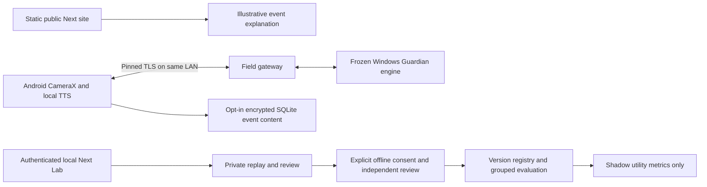

# VISION system architecture V2 — implemented product boundary

Status: local software implementation, physical acceptance pending. This document
reconciles the supplied target proposal; it does not supersede the frozen engine.
See [implementation decisions](IMPLEMENTATION_DECISIONS.md) and
[release checklist](../releases/VISION_PRODUCT_V1_1_CHECKLIST.md).

## Runtime and ownership

- `apps/vision-field-android` owns capture, local voice, consent-independent local
  history and protected pairing. It is a field harness, not standalone inference.
- `field_gateway.py`, `field_pairing.py` and `tools/wireless_alpha.py` own transport
  authorization. Existing frame identities, clocks, uncertainty, latest-frame
  admission and stale-result rules remain authoritative. One paired phone at a time.
- The frozen Alpha manifest identifies the existing Windows runtime and assets.
  Product history, review and optional ranking cannot mutate its decisions.
- `apps/web` supports a loopback private Lab and a separately allowlisted public
  static distribution. Filesystem replay APIs exist only in the private runtime.
- `product_data.py` owns offline consent/version/deletion contracts, local object
  storage, group splits and evaluation. `product_remote.py` is an explicitly enabled
  SDK export boundary; it is not connected to phone collection or a public API.
- The existing Spring backend remains separate. No account system, cloud sync,
  queue service or replacement inference framework is introduced.

## Trust boundaries

The operator displays a fresh QR on loopback. The phone trusts only the certificate
in that physically verified QR, checks its SHA-256 and validity, and retains normal
hostname verification. HTTPS bootstrap exchanges a 120-second single-use code for
a protected device credential. Session grants last at most one hour, bind to one
session, and rotate on reconnect. Re-pair, operator revoke, or gateway restart
invalidates old credentials. Restart requires pairing again; certificates last one day.

Lab sessions require a locally configured random secret (at least 32 characters),
signed HttpOnly SameSite cookies and same-origin login. Raw video additionally
requires explicit `VISION_LAB_MEDIA_ENABLED=1` after media-rights review. Keep Lab
on loopback; a multi-user internet Lab needs identity, rate limiting and deployment
security work beyond this local operator gate.

## Resource boundaries and claims

Inference remains bounded and latest-only. History has a separate bounded worker
queue, 1,000-record/8 MiB database limits, and no camera buffer persistence. Public
pages have no model, GPU connection, account or telemetry dependency. TLS, dataset
and UI tests do not demonstrate physical safety, useful human interruptions or
audible Bluetooth delivery. No Task019 or on-device inference completion is implied.
