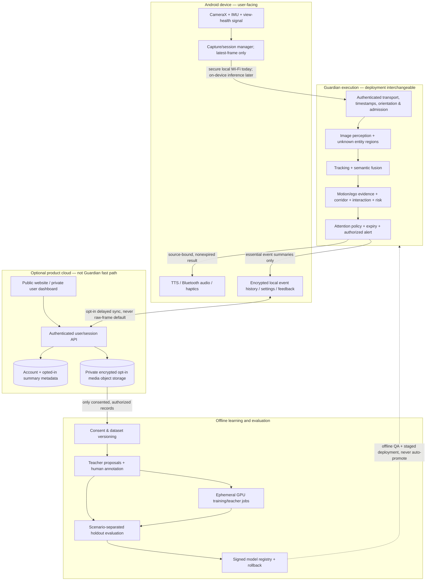

# VISION — Target System Architecture and Evolution Plan
**Status:** Proposed target design, NOT an implemented or qualified release  
**Date:** 2026-11-06  
**Existing baseline:** Frozen VISION Controlled Alpha V1; human usability and physical navigation safety remain unvalidated.  
**Decision scope:** Public website; phone use without USB; user history and retention; image/video perception; feedback learning; affordable data and training platform; modular software architecture.

## 0. Executive architecture decisions

1. **Keep the existing Guardian inference contract and frozen Alpha manifest intact.** Preserve PicoDet-S FP32 CUDA + LK flow CPU + PIDNet-S CUDA as a measured baseline, not an immutable future choice. Existing long-recording benchmark (18,541 updates, 12.368 Hz, publication-age P95 241.947 ms) is source-replay evidence, not physical phone/audio latency or safety validation.
2. **Remove research replay media from the public website** without deleting immutable internal evidence. Replace public examples with short consent-cleared/staged demonstrations, explicitly labeled as demonstrations, and a product-level explanation. Expose the original long recording only in private authorized lab tooling if data rights allow.
3. **Make data ephemeral by default.** Process camera frames in bounded memory, store only meaningful user-visible event summaries in an encrypted on-device database, expire caches, and never enroll footage in training without separate opt-in. Allow users to inspect/export/delete their history. Treat backup/remote copies and deletion propagation as first-class responsibilities.
4. **Do not confuse website hosting with inference hosting.** First eliminate USB via secure Wi-Fi pairing to the local Windows engine. For independent usage away from a PC, plan an optimized Android inference engine; this is new mobile/edge work and cannot be accomplished by hosting the Next.js site. A cloud GPU relay may serve bounded research sessions if specifically funded and performance-qualified, not the default safety path.
5. **Use image detection plus temporal geometry.** A neural image detector extracts entities/regions/concepts; tracking, camera-motion compensation, multi-frame motion, corridor and risk estimate their relationship to the user. Optional temporal video models are offline teachers or bounded event-window enrichers only when they add measured utility. No unvalidated metric depth/speed/TTC.
6. **Learn alert usefulness conservatively.** Begin with independently reviewed event labels and an offline ranking/classification model; keep the deterministic Guardian risk/mandatory-warning floor. Only explore contextual-bandit / preference methods using logged data, simulation and shadow mode. No dangerous online exploration or autonomous suppression of credible hazards.
7. **Create a modular monolith + contract boundaries, not premature microservices.** Keep Python perception and scheduling, Java Guardian, Android Kotlin application, existing web stack, a small BFF/control API, and a versioned dataset/annotation pipeline. Separate three planes: Runtime, Product/History, Research/Learning.

## 1. Architecture overview



**Key separation:** Marketing UI and user history must remain functional when inference is offline; inference must remain functional when public website, cloud synchronization, and annotation infrastructure are down. Browser UX is never in the alert critical path.

## 2. Deployment modes / progression

| Mode | Inference | Phone connectivity | Valid use | Dependency and blocker |
|---|---|---|---|---|
| **M0: Frozen Alpha reference** | Windows RTX 3050 host | USB or existing field harness | Benchmarks/replay, supervised local engineering | Host + field hardware; already frozen |
| **M1: Wireless supervised alpha — next release** | Windows RTX 3050 host | Same Wi-Fi, TLS, QR pairing with short-lived token | Safe controlled supervised developer evaluation | Laptop must be on, phone and PC on reachable network; verify firewall, discovery and actual phone audio |
| **M2: Independent Android trial** | Quantized/mobile-suitable detector + ported bounded Guardian components on device | None for core inference/TTS | Controlled offline trials only after per-device qualification | New mobile inference implementation; characterize battery/thermals/latency/orientation/reliability; no assumed parity with M0 |
| **M3: Optional research cloud relay** | Paid ephemeral GPU inference service | Internet, encrypted authenticated session | Limited experiments, not authoritative navigation | Real network/queue/TTS tail latency and uptime, privacy, cost ceiling; unavailable service must show unavailable, not safe |

**Immediate UX:** M1 removes USB *after* first setup; QR contains server address or discoverable name, public fingerprint/pinned cert info and single-use pairing secret. Do not trust arbitrary self-signed certificates or introduce `trustAll` in Android. Connection status and fallback should be obvious. A public website cannot see a user's local `127.0.0.1` Windows inference server.

## 3. Perception, temporal reasoning and alerts

### 3.1 Fast path

```
Camera frame + PTS + metadata
  -> view-health & orientation capability
  -> fast model: regions + calibrated/uncalibrated semantic evidence + UNKNOWN regions
  -> track generation and bounded temporal fusion
  -> scene/ego-motion quality (flow is not automatically user velocity)
  -> geometry-based corridor, trajectory, interaction and risk
  -> conservative attention & expiry/dedupe
  -> app-local TTS and compact history event.
```

**What is known?** A 2D detector identifies regions and class proposals. Different objects need different evidence, and classification alone cannot prove motion, depth, collision path, user heading or physical scale. Running video models on every frame is not a prerequisite to temporal reasoning; tracks and optical flow already integrate information across frames.

### 3.2 Optional neural layers

- **Image semantic teacher:** Offline open-vocabulary/crop model proposes labels, assessed against reviewed truth. Do not mistake pseudo-labels for accuracy.
- **Event clip teacher:** A bounded 1–3 second event-centric temporal model may analyze interaction patterns *offline*, or in a nonblocking async slot, only after paired measurements show it outperforms frame+tracking baselines in human-judged relevance or motion error.
- **Mobile student:** Quantized/optimized small detection model evaluated on representative Android devices, ideally with on-device acceleration; only promote with per-device and scenario-parity tests.
- **Preference/utility model:** Separate, calibrated model over bounded event features. Must not overwrite authoritative geometry or suppress mandatory credible hazard warnings.

### 3.3 Alert policy contract

`GuardianHazardDecision` owns the safety/attention eligibility floor. `AlertUtilityScore` is a *secondary* learning recommendation that may rank/tune low-risk informational notices; it may not discard `MUST_NOTIFY` events or turn UNKNOWN/unusable camera into an all-clear. A credible imminent interaction should alert even if the user previously disliked some alerts; uncertainty and detection limits still apply.

Policy states: `MANDATORY_WARN`, `OPTIONAL_INFORM`, `SILENT`, `UNAVAILABLE`; explicit reason, evidence, confidence basis, expiry, device capability, source age and semantic authorization. **No safety claim without physical truth.** Test false negatives, not just interruption reduction.

### 3.4 No unsafe online RL

Starting model: supervised calibrated relevance/interruptibility predictor trained on reviewed examples; optional pairwise preference learning for phrasing and priority. If studying contextual bandits later, log action selection probabilities for valid off-policy estimators and run in shadow/simulation first. Deterministic historic logs without propensities cannot magically identify counterfactual effects. Never randomize hazard-warning suppression on actual users. Any learned policy requires held-out evaluation, uncertainty/abstention and rollback.

## 4. Product UX and history

### 4.1 Public website

New routes / product identity: `/` (product + mission + truthful claim), `/how-it-works`, `/demo` (short consent-cleared clips), `/technology` (factual status), `/privacy`, `/limitations`, `/research` (only public-approved evidence). A private `/lab` contains the long frozen benchmark replay, provenance, and reviewer tools after authentication; if rights/consent are insufficient, serve only private local research instead of public media. The public landing page should not autoplay or embed 24.98 minutes of raw footage. The original recording remains in immutable private benchmark storage.

Design system: premium simple type, accessible hierarchy, touch-first layout, WCAG 2.2 AA target, no green *safe* badge, clear degraded/disconnected states; show an actual 15–45 second demo with captions/audio transcript and a simple `Saw → Tracked → Considered → Said/Stayed silent` explanation. Narrow-device QA is required before release; earlier viewport visual QA was not completed.

### 4.2 Android

Home: `Start supervised session`, status, `Test audio`, accessible `Stop`, recent important events, feedback. A first-use setup wizard includes device/camera permission, local pairing, TTS voice selection, optional data contribution and safety limitations. Session should remain usable without account/login if offline/local. Screen-reader support and large targets matter more than animated overlays.

### 4.3 User history schema — event summaries only

```json
{
  "schema": "vision.history.event.v1",
  "event_id": "uuid",
  "session_id": "uuid",
  "event_time_utc": "timestamp",
  "type": "ALERT_PRESENTED | CAPABILITY_CHANGED | USER_FEEDBACK",
  "semantic_summary": "vehicle",
  "short_message": "Vehicle crossing from right",
  "reason_codes": ["VERIFIED_REASON_CODE"],
  "source_age_ms": 0,
  "capability_state": "READY | DEGRADED | UNAVAILABLE",
  "model_release_id": "frozen_manifest_hash",
  "review_state": "UNREVIEWED | REVIEWED | AMBIGUOUS",
  "media_reference": null,
  "expires_at": "timestamp-or-null"
}
```

User history stores **what the system actually output** and declared capabilities, not claims of correct hazard recognition. No raw image, full coordinates, face/name or continuous location trail by default. The history record is *not* an automatic independent truth label.

### 4.4 Retention and deletion — policy proposal, must be implemented/tested

| Data class | Proposed default | Consent and control |
|---|---|---|
| Frame buffers | Volatile only | Release after processing; bounded latest-frame queues; no persistent copy |
| Temporary diagnostic image/clip | Off; if explicitly enabled, delete within 24 hours | Separate session consent; user-controlled size quota |
| Detailed session telemetry | Local, suggested 7 days | Short diagnostic retention; no media by default |
| Important event history | Local, suggested 30 days or user-configured | Export/delete/disable; encryption at rest |
| Cloud history sync | Disabled until opted in | Per-user access policy; selective records; explicit revoke/delete |
| Contributed training media | Separate explicit opt-in and revocable consent where applicable | Versioned data lineage; scoped access; defined retention and deletion consequences |
| Immutable developer benchmark | Separate private controlled dataset | Preserve research hashes and authorized media; never mix with user cache |

For deletion: direct-delete active record, tombstone and reconcile replicas/object references, garbage-collect blobs after retention/legal constraints, handle backups via documented retention policy, verify deletion via tests. TTL cleanup is not instantaneous (e.g. Firestore TTL and R2 lifecycle may be delayed); never promise immediate removal from all copies without capability. Remove thumbnails/sessions from app disk caches as well as cloud stores. Use WorkManager for resilient cleanup when app is offline. Add user-accessible storage meter, quotas and clear cache vs delete history vs withdraw training contribution commands.

## 5. Backend / storage without expensive cloud GPU

### 5.1 First deployment recommendation

- Public marketing site: static frontend on Cloudflare Pages/Workers or equivalent CDN. Keep private replay routes off public by default. If existing Next.js uses Node file-system operations/SSR, isolate to static product pages; evaluate adapter compatibility rather than automatically rewriting the full app.
- Android history: encrypted local Room/SQLite and app-private files; Android Keystore for encryption keys; no account needed for basic functionality.
- Opt-in cloud metadata/auth: small authenticated API / managed auth + relational DB only if multiple devices and history sync truly require it. Implement `Account`, `Session`, `HistoryEvent`, `Review`, `ConsentGrant`, `MediaArtifact`, `DeletionJob`, `DatasetVersion`, `ModelCandidate` contracts; prohibit raw video payloads in metadata DB.
- Private media: S3-compatible object storage (e.g. Cloudflare R2) as an adapter, private bucket, signed short-lived access, no default uploads. Separate production user data from research data, with tenant-level auth and encryption.
- Research: use original Windows laptop for ETL, review, small teachers; on-demand GPU rental only for measured, bounded training jobs; shut down when idle, maintain checkpoints and budgets. Never build always-on GPU inference without knowing cost/user/latency requirements.

**Public website hosting ≠ Guardian inference.** Cloudflare R2 Standard currently documents 10 GB-month monthly free storage and free egress; operation quotas and other costs apply. Costs, quotas and terms must be rechecked before provisioning. Vercel Hobby explicitly restricts commercial usage, so don't assume a startup product can use it as permanent free production hosting.

### 5.2 Cost levers

`cost ≈ stored media GB-month + object operations + authenticated API/DB + GPU-hours + inference transfer + monitoring`. Spend on **label quality, held-out scenario coverage and on-demand jobs**, not permanently idling GPU hardware. Choose one cloud provider per functional plane initially; avoid cloud microservice sprawl.

## 6. Dataset / labeling / training lineage

```
Consented capture OR licensed external data
 -> verify consent/scope, timestamp and owner
 -> redaction/restriction review
 -> immutable, hashed, session-scoped raw artifact (if authorized)
 -> offline teacher proposals + geometry/temporal evidence
 -> uncertainty mining + scenario diversity selection
 -> independent human labels (object/motion/alert usefulness)
 -> quality reconciliation and dataset version
 -> split by recording route/session/participant (no adjacent-frame leakage)
 -> baseline vs candidate experiments
 -> fixed independent holdout, false-negative audit, runtime tests
 -> model registry with rollback
 -> staged shadow / developer / supervised deployment.
```

Annotate on different axes:
- Perception: physical entity existence, box/mask, correct concept, occlusion, visibility, unknown.
- Motion: movement vs camera shake, track continuation, motion interaction; mark unresolvable metric distance/TTC as UNKNOWN.
- Attention: would a supervised human want an interruption, was it too early/late, what did it miss, did system stay silent appropriately, user discomfort, ambiguity.

**Essential:** label *negative* events and missed events, not only delivered alerts. Observational records from the existing detector have selection bias. Feedback-driven model selection must include an independent manually annotated set of nonalerts and atypical events. Report scenario-wise false-negative rate and confidence intervals instead of only global accuracy. Existing 24-minute footage includes nonwalking segments and is not adequate alone for physical walking generalization.

### 6.1 Reinforcement learning research gate

Stage A: deterministic baseline + reviewed data, user preference research and usefulness metric specification.
Stage B: supervised ranking/importance model, offline replay and cost-sensitive error penalties, shadow mode.
Stage C: optional contextual-bandit/offline policy research only with correct logged action-propensity/coverage assumptions, synthetic interventions, conservative constraints and independent review. No exploration in actual hazard decisions.
Stage D: hypothetical production consideration after physical and human evidence, not an Alpha acceptance criterion.

Model promotion must not improve quietness at the expense of missed important warnings; mandatory Guardian safety/availability constraints remain external to learned policy.

## 7. Versioned interfaces and ownership

| Contract | Owner | Min fields | Non-negotiable invariant |
|---|---|---|---|
| `FrameEnvelope.v2` | Android capture | session, frame ID, capture monotonic time, dimensions, orientation quality, camera characteristics, image reference, consent flags | No raw cross-device monotonic comparison; latest-frame only |
| `GuardianObservation.v1` | Python perception | observation ID, parent frame, bbox/mask, semantic evidence, score basis, provider/hash | UNKNOWN region stays physical; no falsely calibrated score |
| `GuardianDecision.v1` | Java Guardian | track generation, interaction/risk evidence, urgency, reason codes, expiry, heading/view capability | Physics/attention decides; explicit UNKNOWN and unavailable |
| `AlertEnvelope.v1` | Gateway → Phone | alert ID, session, event lineage, text, original timestamp/age, expiry, status | Deduplicate, drop expired/superseded, never replay backlog |
| `ImportantEvent.v1` | Product | event/session ID, timestamp, exact spoken text or capability event, provenance, expiry | No raw images or independently verified claims by default |
| `Feedback.v1` | User/Reviewer | event reference, relevant/irrelevant/unknown, timing, optional note, reviewer provenance | User rating != ground truth; no direct training on opt-out data |
| `ConsentGrant.v1` | Product privacy | participant, data type/purpose, choice, timestamp, expiry/revoke | Service-use consent separated from model-training consent |
| `DatasetManifest.v1` | Learning platform | license/consent, source hashes, split/group, annotations, model version, tombstone status | Immutable versioning, deletion lineage |
| `ModelRegistry.v1` | Learning platform | artifact digest, evaluation IDs, latency/power by target, training provenance, approval | No autopromotion into safety-critical Guardian |

Keep existing protocol names and adapt them rather than duplicating incompatible schemas; names above are conceptual targets to map into current code. Use an ADR whenever proposing an irreversible contract change.

## 8. Product phases and explicit release gates

### Release P1 — Product + wireless local Alpha (first)

Deliver polished website removing 24-minute public video; private lab gated; pairing QR over local Wi-Fi with TLS/cert pinning; Android session start/stop/TTS physical device test; encrypted local important event summaries and cleanup; reliable review autosave, privacy choices; end-to-end session logs; documented no-PC-unavailable behavior. **Required to claim done:** real-device video and audio measured, no USB dependence after pairing, bounded backlog, connection loss states, safe deletion/retention tests, actual responsive and accessibility checks. If phone not connected, mark hardware gate pending rather than passing it via emulator.

### Release P2 — Dataset/learning platform (next, may overlap independent P1 tasks)

Deliver opt-in media capture/import, redaction review, checksummed artifacts, review UI, annotation schema, scenario/route-separated dataset manifests, local evaluation and candidate registry; optional cloud storage interface disabled by default. **Required:** independent reviewed event/negative samples, reproducibility and explicit consent/deletion tests. Do not auto-download large datasets or train on unreviewed pseudo-labels as truth.

### Release P3 — Standalone Android Guardian (substantial product engineering)

Port smallest measurable mobile inference + runtime modules with explicit quality and battery/power tests on actual target phone; compare against frozen Windows Alpha on same consented labeled conditions; fail closed to unavailable when device overheats, lacks camera view or misses deadlines. On-device speech and basic important-event history should work with no PC and no Internet. **Not accomplished by P1 or cloud website hosting**.

### Release P4 — Utility model & deployment

Independent prospective human review + shadow policy, only then consider utility learning model. Never make RL a requirement for initial supervised prototype; no automatic real-world safety-policy exploration. Open a controlled private beta only after on-device or clearly documented supported inference mode, consent/retention policies, feedback and adverse-event handling.

## 9. Audit gates and product metrics

- Runtime: full camera→Android TTS start-age distribution (with clock uncertainty), long-run publication P50/P95/P99, expiries, dropped frames, OOM/thermal, worker disconnect, camera-health and orientation degraded cases.
- Perception: human-labeled recall/precision of physically relevant entities, UNKNOWN retention, semantic quality, class confusion, rotated/low-light outcomes, independent unseen sites/participants.
- Motion & safety: static-vs-moving classification; head motion vs entity motion; verified relevant interaction recall and timing; **missed hazards and misleading alerts are explicit failure metrics**; no unvalidated metric depth/TTC.
- Attention: useful warnings, unnecessary interruptions, late/early/missed important warnings, silent decision correctness; review disagreement and comfort/annoyance.
- Product: device onboarding success, pairing time, first-test completion, TTS reliability, history storage bytes/user/day, retention/deletion latency, accessibility issues.
- Data pipeline: consent coverage, annotation quality, route-split leakage checks, sample diversity, model candidates reproducibly benchmarked, cloud spend with hard caps.
- Privacy/security: per-user authorization, signed uploads, deletion audit, logging redaction, encrypted caches, no public media exposure, no secret upload, legal review of recordings of bystanders and vulnerable users.

## 10. Architectural decision records to create in repo

`ADR-001-runtime-vs-product-vs-learning.md`; `ADR-002-wireless-local-first.md`; `ADR-003-public-demo-data-policy.md`; `ADR-004-history-retention-deletion.md`; `ADR-005-image-temporal-model-boundary.md`; `ADR-006-alert-usefulness-and-no-online-RL.md`; `ADR-007-consent-and-data-versioning.md`; `ADR-008-cloud-cost-gates.md`; `ADR-009-mobile-inference-roadmap.md`.

## 11. Sources / references checked 2026-11-06

- ONNX Runtime mobile: https://onnxruntime.ai/docs/tutorials/mobile/ (Android NNAPI/XNNPACK availability; benchmark per device).
- CameraX ImageAnalysis: https://developer.android.com/reference/androidx/camera/core/ImageAnalysis (KEEP_ONLY_LATEST behavior).
- Cloudflare R2: https://developers.cloudflare.com/r2/pricing/ and https://developers.cloudflare.com/r2/buckets/object-lifecycles/ (costs and deletion delays).
- Cloudflare static Next.js: https://developers.cloudflare.com/pages/framework-guides/nextjs/deploy-a-static-nextjs-site/ ; full-stack Next.js on Workers: https://developers.cloudflare.com/workers/framework-guides/web-apps/nextjs/ (compatibility test before migration).
- Vercel Hobby restrictions: https://vercel.com/docs/plans/hobby .
- Firestore TTL: https://firebase.google.com/docs/firestore/ttl (automatic deletion not immediate; must separately handle subcollections, backups and user-initiated deletion).
- Safe offline RL literature: https://ijcai.org/proceedings/2024/913 and https://proceedings.mlr.press/v206/bennett23a.html (research perspective, not validation for this product).

**Important:** This design is not a certification, safety guarantee, or a claim that these changes are already present in the repo. Cloud providers/prices and model licenses must be rechecked before provisioning or shipping. Real phone data rights, consent and safety evaluation remain external gates.
