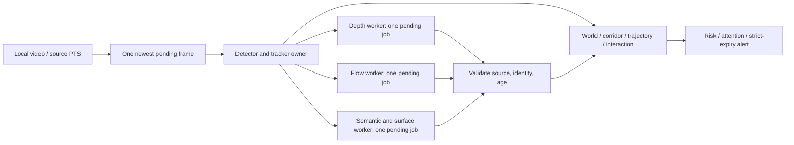

# V0 rescue architecture

The experimental `realtime_rescue` configuration separates paced acquisition,
optional perception and the single owner of tracking/world/reasoning state.
It is opt-in. Offline replay retains its existing process-all execution path.

Workers never mutate WorldState. Each provider executes on a single worker,
retains one in-flight job, one replaceable pending job and one replaceable result.
Exceptions are sticky and terminate the session rather than disappearing behind
a newer result. Model construction remains outside frame processing.

Older accepted depth can describe source-level depth availability, but cannot be
sampled against newer detection or track boxes. Older flow can supply camera-motion
evidence; current-object exclusion masks and track-flow associations require exact
frame identity. Historical per-object depth association is not implemented by this
rescue and remains unavailable. This limit is preferable to inventing fresh depth.

All output status, validation and physical-accuracy limitations continue to apply.
The new scheduler is not a safety qualification.

Independent enrichment jobs are submitted before synchronous detector execution;
they do not wait for detector output. A synchronized regression test verifies
that an enrichment worker can start while detection is still running.
Completed enrichment is polled after detection, so work completed during inference
can be consumed immediately without waiting or relabelling its source timestamp.

The measured reasoning hotspot uses a bounded 32-entry cache of immutable polygon
edges. It retains geometry only: no image, observation, distance result, risk or
attention decision is cached. Signed distances are recomputed for every point.
This avoids repeated polygon preparation and temporary lists without changing
the corridor algorithm, tolerances, source evidence, or validity gates.
Only polygons with at most 16 vertices enter the cache; larger polygons are
computed without retention. The full 18,000-frame offline regression preserves
all conditional funnel counts, attention dispositions and text outputs.
